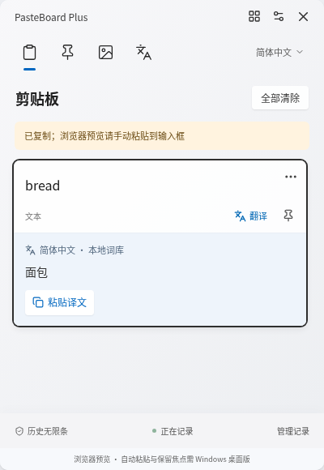
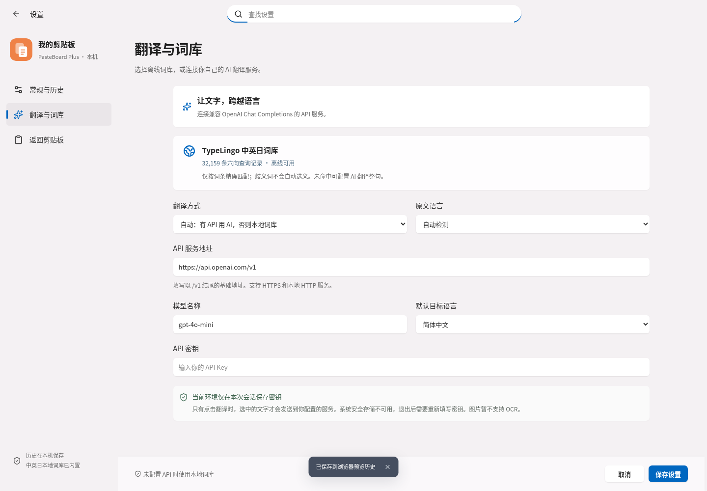

# PasteBoard Plus

给每一次复制，一个好去处。一个类似 Windows + V 的桌面剪贴板，基于 Electron、React 和 TypeScript，主要面向 Windows，也可在 macOS / Linux 上开发运行。

## 下载 v0.1.3

- [Windows x64 安装程序](installers/PasteBoard-Plus-Setup-0.1.3-x64.exe?raw=true)：双击安装，可选择安装位置。
- [Windows x64 便携 ZIP](installers/PasteBoard-Plus-0.1.3-win-x64.zip?raw=true)：完整解压后运行 `PasteBoard Plus.exe`。
- [SHA-256 校验文件](installers/SHA256SUMS.txt)。安装包通过 Git LFS 存储；直接点击上述链接下载即可。克隆时如需同时获取二进制文件，请安装 Git LFS。

此版本采用 Win11 风格的浅色卡片、阴影与清晰文字。默认使用 400×580 小窗口，打开设置或管理记录时才切换到大窗口；内置用户提供的中英日词库。安装包未签名；Windows 保持焦点、光标跟随与自动粘贴已完成实现和编译检查，尚未在真实 Windows 桌面验证。

## 已实现

- **小窗口优先**：启动、托盘和全局快捷键默认唤出 400×580 小窗口。Windows 小窗口不激活、不抢输入框焦点；点选条目复制并向原输入框发送粘贴，然后收起。设置和管理记录才进入大窗口。
- **跟随输入位置**：Windows 从原生光标或 UI Automation 获取位置，窗口靠近光标并随其移动，避开屏幕边缘；无法获得精确光标时使用输入控件位置，再降级到鼠标位置。原窗口或输入框改变后自动收起，粘贴前再次检查目标。
- **清晰设置**：Win11 风格设置侧栏和卡片，文字可选 14 / 16 / 18 px；可关闭自动粘贴，只复制内容。
- **自动历史**：每 800 ms 检查系统剪贴板，记录文字和链接，去重并保存到本机；退出、重启后恢复。默认无限条。
- **可选快捷键**：默认 `Ctrl + Shift + V`，macOS 为 `⌘ + Shift + V`。在设置中按下新组合即可更改；注册失败时提示冲突。`Windows + V` 由系统占用。
- **智能分类**：文本、图片、URL、代码；文件及文件路径不再记录，旧版本保存的路径可在管理界面查看。可以创建、删除自定义分类，并将记录收纳进去。
- **历史管理**：搜索原文 / 译文，置顶，网格 / 列表视图，排序，单条删除，清理时默认保留置顶内容。
- **图片（可选）**：默认关闭，在设置中开启后记录新复制的图片。保存原始 PNG、缩略图、尺寸及大小；支持查看原图和重新复制图片，不设文件大小或像素数量上限。
- **行内翻译**：每条文字记录旁有翻译按钮；译文展开后可直接粘贴。自动模式有 API Key 时使用 AI，否则使用内置 TypeLingo 中英日词库；也可强制本地或 AI。AI 支持中 / 英 / 日 / 韩 / 德 / 法语。
- **后台运行**：关闭窗口后继续在托盘记录；快捷键再次打开，托盘菜单可暂停或退出。

Windows：先点击目标输入框，按设置的快捷键调出小窗口，再用鼠标点击词条或「粘贴译文」。小窗口保持原输入焦点，输入内容不会被程序读取。原输入框改变、权限较高的程序拒绝模拟输入、辅助服务被系统策略禁用时，会提示原因并保留复制结果，可手动 `Ctrl + V`。没有强制切换前台窗口或请求管理员权限。

Windows 小窗口保留输入焦点，因此方向键和打字仍作用于原输入框；`Escape` 收起小窗口。管理界面提供搜索和完整操作。macOS / Linux 暂时只复制并收起，请回到原应用手动粘贴。

默认小窗口实测预览：





## 运行

需要 **Node.js 24+** 和 npm。使用已有 checkout；每个云任务已隔离，无需创建 Git worktree。

```bash
cd /workspace/pasteBoard-plus
npm ci
npx --no install-electron
npm run dev
```

`dev` 启动 Vite 和 Electron，界面修改会热更新。修改 `electron/` 或 `shared/` 的桌面逻辑后重启开发进程。

```bash
npm run build        # 类型检查、前端和 Electron 主进程 / preload 构建
npm start            # 运行已构建桌面版
npm run dev:web      # 仅浏览器界面预览
npm run dist:win     # Windows x64 安装程序 + 便携 ZIP
npm run pack         # 当前平台的未压缩应用目录
```

Windows 安装程序输出到 `release/PasteBoard-Plus-Setup-0.1.3-x64.exe`，可选择安装位置并创建桌面快捷方式。便携包输出到 `release/PasteBoard-Plus-0.1.3-win-x64.zip`。解压整个 ZIP 后运行 `PasteBoard Plus.exe`。Windows 输入辅助服务使用系统自带的 Windows PowerShell / .NET Framework，无需安装开发 SDK。

浏览器预览明确标注其模式：只能在点击「捕获剪贴板」时读取浏览器获准访问的文字，历史保存在此浏览器中。示例须手动载入；不会把示例加入桌面历史。系统全局快捷键、自动监听和 AI 请求由桌面版提供。

## 配置翻译与本地词库

打开「设置 → 翻译与词库」。默认自动模式在未配置 API 时查本地词库；配有 API 时使用 AI。选择「仅本地词库」可始终离线运行。需要整句翻译或更多语言时：

1. 填入基础 API 地址，例如 `https://api.openai.com/v1`；程序自动追加 `/chat/completions`。
2. 填入服务实际支持的模型名，例如 `gpt-4o-mini` 或 `deepseek-chat`。
3. 输入自己的 API 密钥，保存。点击小窗口词条旁「翻译」，或管理界面的「翻译这段内容」。

服务需支持 `POST /chat/completions`、Bearer 认证及 `choices[0].message.content` 响应。远程服务必须使用 HTTPS；本地模型可使用 `http://localhost:端口/v1` 或 `http://127.0.0.1:端口/v1`。支持环境已有的 HTTP(S) 代理和 CA 信任；不跟随 API 重定向。

只在点击翻译时发送**所选条目的文字**，不发送整个历史或图片。不含 OCR。真实外部服务需要用户在桌面设置中配置有效凭据；自动测试使用本机模拟 API，不产生付费请求。

本地词库来自用户提供的 **TypeLingo-Vocabulary-zh-en-ja-v1**，包含 32,159 条中英日六向查询记录；另有 2,441 个歧义查询键，不自动选义。支持词或短语精确匹配、去除首尾空白、英文忽略大小写；不是整句翻译模型。未命中或存在歧义会明确提示，可指定原文语言或配置 AI。词库压缩后约 290 KiB。

词库汇编版权归 2026 TypeLingo vocabulary authors，按 CC BY 4.0 使用；许可、来源和变更说明位于 [assets/vocabulary](assets/vocabulary)。原始附件保留在 `vendor/vocabulary/TypeLingo-v1.zip`，只作为数据读取，未执行其中脚本。可运行 `python3 scripts/import-vocabulary.py` 校验附件并重新导入；原始附件不随安装包分发。

## 数据与存储

数据位于 Electron 的 `userData` 目录：

| 系统 | 默认位置 |
| --- | --- |
| Windows | `%APPDATA%/pasteboard-plus/` |
| macOS | `~/Library/Application Support/pasteboard-plus/` |
| Linux | `~/.config/pasteboard-plus/` |

`history.json` 保存文字、分类、设置及译文，`images/` 保存原图。JSON 通过临时文件和原子重命名保存；无法读取的历史文件保留为 `history.json.recovery-*`，不会直接覆盖。桌面应用以实际 `app.getPath('userData')` 为准，打包后的目录名可能随系统 / 产品名变化。

API 密钥通过 Electron `safeStorage` 使用系统能力加密。系统安全存储不可用（包括 Linux `basic_text` 后端）时，只保存在进程内存，退出后重新输入；不会降级为明文文件。密钥不会暴露给界面快照或保存到源码。历史内容本身为本地明文文件。

历史默认无限条、不自动淘汰；可以在设置中选择预设容量或自定义任意非负整数，0 表示无限。置顶数量没有固定上限，设置有限容量时会保留置顶。记录列表分批显示以减少界面占用，加载更多可访问更早的记录。升级时保留旧历史，旧版默认的 300 条迁移为无限条，其他已选容量继续保留。图片不设文件大小或像素数量上限，原图完整保存，只缩放界面中的缩略图。原始文字上限 100,000 字；翻译每条最多 20,000 字，超限文字会提示。程序跳过来源应用标记为敏感的剪贴板内容，但并非所有密码来源都会附加这类标记。

文件及文件路径不会加入新历史，也不会被读取、移动或删除。图片记录默认关闭，启用后只记录图片剪贴板内容。链接只作为文字展示，不主动访问网页。

## 验证

```bash
npm test                       # 分类、持久化、容量、恢复和翻译错误处理
npm run test:e2e                # 浏览器端到端交互
npm run test:desktop            # 在可用桌面中测试真实 Electron 剪贴板
npm run test:desktop:headless   # Linux 无显示器环境；自动启动 Xvfb 或 Xorg dummy
npm run verify:package          # 检查实际打包内容及依赖/语言精简
PASTEBOARD_SMOKE_APP=release/win-unpacked/resources/app.asar npm run test:desktop:headless # 直接验证生产归档
dotnet build native/NativeCheck.csproj # 可选：使用 .NET SDK 和微软 net48 引用程序集编译检查 Windows 辅助代码
# 真实 Windows 交互式桌面中运行：
powershell.exe -NoProfile -STA -File scripts/test-windows-focus.ps1
```

浏览器测试默认使用 `/usr/bin/chromium`；其他环境通过 `PLAYWRIGHT_CHROMIUM_PATH` 指向已安装的 Chrome / Chromium。例如 Windows 可设置为本机 Chrome 可执行文件路径。

桌面测试使用独立的临时数据目录和本机 HTTP 模拟服务，验证默认小窗口和管理 / 设置尺寸切换、文件跳过、图片默认关闭及手动启用、系统文字 / 图片读写、自动分类、敏感标记、暂停 / 恢复、全局快捷键注册、安装包内词库查词与复制、翻译 UI 到 API、重启恢复和图片清理。不会读取已有应用历史，也不会调用真实 AI 服务。

Windows 专用脚本创建自己的测试输入框，检查光标获取、Unicode 粘贴、焦点保持以及拒绝已改变的目标；仅访问测试框文字，结束后恢复剪贴板。编译检查不能替代 Windows 实机测试，云端 Linux 测试未覆盖 Windows 原生输入行为。

云环境通过现有网络代理访问 npm、GitHub 官方 Electron 发布资源。Node.js 下载器需要使用代理时：

```bash
NODE_USE_ENV_PROXY=1 npm ci --no-audit --no-fund
NODE_USE_ENV_PROXY=1 npx --no install-electron
npm run build
npm test
npm run test:e2e
npm run test:desktop:headless
```

当前云环境自带 Chromium、GTK 和 Xorg dummy，无需 Docker 或外部数据库。`scripts/with-display.mjs` 只启动自己的虚拟显示器，并在子进程退出后清理。对于不支持 Chromium 沙箱的隔离云容器，`npm run start:cloud` 使用测试用 `--no-sandbox` 启动；正常桌面用户请使用 `npm start`。

在 Linux 云环境生成 Windows 安装程序时，运行 `NODE_USE_ENV_PROXY=1 npm run dist:win`。安装程序使用标准 NSIS 脚本，在安装时生成卸载程序，构建时无需 Wine；直接嵌入 NSIS 兼容的压缩载荷，并使用官方解压宏安装，避免重复打包未压缩文件。支持选择安装位置、创建桌面 / 开始菜单快捷方式，并注册 Windows 卸载入口；卸载时保留独立的剪贴板历史目录。

## 目录

```text
electron/        系统剪贴板、托盘、快捷键、IPC、历史文件与 API 请求
shared/          类型、默认设置、内容分类
src/             React 界面与独立浏览器预览适配器
assets/windows/  Windows 输入辅助服务与光标定位代码
assets/vocabulary/ 词库许可与来源
public/vocabulary/ 压缩后的离线词库
native/          Windows 辅助代码编译检查项目
scripts/         开发、构建、虚拟显示器与原生桌面烟测
tests/           单元测试和浏览器端到端测试
```

已在 Linux 云环境验证；Windows 便携包的原生运行、Windows 快捷键冲突和 macOS 权限行为需要对应系统验证。Linux Wayland 的全局快捷键 / 后台剪贴板访问受桌面会话限制，当前桌面验证使用 X11。

## 体积精简

界面依赖在构建时合并，不再随运行时重复携带完整的 React、图标库及 Zod 源码；发行包不含调试 source map。Chromium 只保留中英文资源，AI 翻译仍支持原有全部目标语言。安装包仍包含离线运行所需的 Electron / Chromium，没有改成需要联网下载主体的安装器。

下载目录仅保留当前版本，旧版本可从 `v0.1.1`、`v0.1.2` 标签获取。

与 v0.1.1 的实测体积对比（v0.1.3 离线完整包，含本地词库）：

| 项目 | 旧版 | 新版 | 减少 |
| --- | ---: | ---: | ---: |
| 安装版 EXE | 155.72 MiB | 108.10 MiB | 30.6% |
| 便携 ZIP | 151.13 MiB | 135.95 MiB | 10.0% |
| 解压后应用 | 400.28 MiB | 312.16 MiB | 22.0% |
